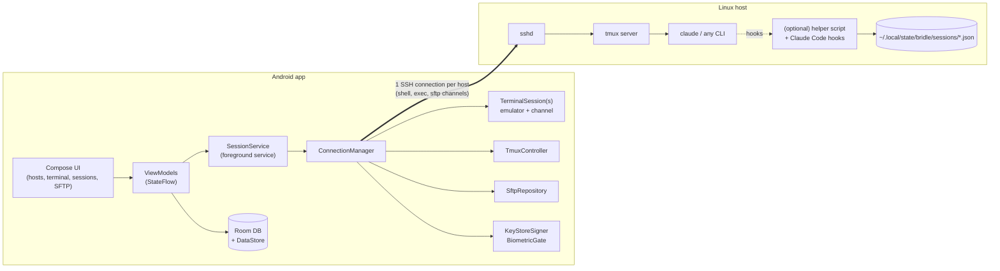

# 02 — Architecture

## 1. Overview



Key ideas:

- **The work lives in tmux on the host, not in the app.** The app attaches to
  it and can be killed, rotated or put to sleep at any time without losing
  work. Reconnecting means `tmux new-session -A -s <name>`.
- **One SSH connection per host, multiplexed**, like OpenSSH ControlMaster.
  Interactive shells, short `exec` commands (tmux queries and helper calls),
  SFTP, and port forwards all share it.
- **The core is plain JVM code.** The SSH, tmux and command-building layers have
  no Android dependencies, so they can be tested on CI against a real `sshd`
  container.
- **Narrow seams around risky dependencies.** The SSH library and the terminal
  emulator each sit behind a small interface (ADR-0001, ADR-0002).

## 2. Tech stack

| Concern | Choice |
|---------|--------|
| Language / UI | Kotlin 2.x, Jetpack Compose, Material 3 (dynamic color) |
| Architecture | MVVM + unidirectional data flow; Coroutines/Flow |
| DI | Hilt |
| Persistence | Room (structured data), Proto DataStore (preferences) |
| SSH | **sshj** behind `SshEngine`; fallback Apache MINA SSHD (ADR-0001) |
| Terminal | **ConnectBot `termlib`** (libvterm, Compose) behind `TerminalSurface`; fallback Termux `terminal-view` (ADR-0002) |
| Crypto | Android Keystore / StrongBox; BiometricPrompt; Tink for backup-file encryption |
| Serialization | kotlinx.serialization |
| Build | Gradle KTS, version catalog, convention plugins |
| Quality | ktlint/detekt, Android Lint, JUnit5, Turbine, Robolectric, Compose UI tests, Testcontainers (sshd) |
| SDK | minSdk 28 (StrongBox APIs); target the latest SDK Play requires |
| App id / namespace | `com.kitefoldlabs.bridle` |
| Licensing | Apache-2.0. Dependencies must be Apache-2.0-compatible (Apache, MIT, BSD); no GPL code, which rules out copying from the Termux app itself. A license-report Gradle check runs in CI |

## 3. Module layout

```
:app                      navigation, DI graph, theme, deep links
:core:model               pure Kotlin data classes (Host, Identity, LaunchProfile, …)
:core:data                Room DB, DAOs, repositories, DataStore, backup import/export
:core:security            Keystore key generation, KeyStoreSigner, BiometricGate, Tink
:core:ssh        (JVM)    SshEngine interface + sshj impl, ConnectionManager, known-hosts,
                          ProxyJump, keepalive/reconnect policy, ShellQuote
:core:tmux       (JVM)    TmuxController: command builders + output parsers
:core:terminal            TerminalSurface interface + termlib adapter, key bar,
                          compose box, gesture handling
:core:ui                  design system, shared components
:feature:hosts            host list/editor, groups, ssh_config import
:feature:keys             identity list, key generation, "install key on host"
:feature:terminal         terminal screen, tabs, session service binding
:feature:sessions         tmux session browser, Launch Profiles, Claude actions
:feature:sftp             file browser, transfers, small-file editor
:feature:snippets         snippets and quick commands
:feature:settings         appearance, keyboard, security, backup
host-helper/              POSIX sh helper + hook installer (shipped as an app asset)
```

## 4. Data model (Room)

```kotlin
Host(id, label, hostname, port=22, username, identityId?, jumpHostId?,
     groupId?, tags, color, keepAliveSec=30, defaultTmuxSession?, // null = plain shell
     startupCommand?, env: Map, terminalProfileId?, lastConnectedAt)

Identity(id, alias, source /*KEYSTORE|IMPORTED*/,
         keystoreAlias?,                 // KEYSTORE: hardware key handle
         encryptedKeyFile?,              // IMPORTED: AEAD ciphertext of the OpenSSH key
         algorithm /*ECDSA_P256|ED25519|RSA_3072|…*/,
         publicKeyOpenSsh, requireUserAuth, authValiditySec, createdAt)

KnownHost(host, port, keyType, publicKey, fingerprintSha256, addedAt, lastSeenAt)

Group(id, name, color, defaultIdentityId?, defaultUsername?)

LaunchProfile(id, hostId, name, sessionName, workingDir, command,
              restartMode /*RESPAWN_CONTINUE|RESPAWN_FRESH|SEND_KEYS*/,
              restartCommand?, env: Map, mode /*SHELL_HOSTED|DIRECT*/,
              icon, pinned)

Snippet(id, name, body, variables: List<Var>, packageId?, runMode /*PASTE|EXEC*/)

PortForward(id, hostId, type /*LOCAL|DYNAMIC|REMOTE*/, bindPort, destHost?, destPort?, autoStart)
TerminalProfile(id, fontFamily, fontSize, theme, cursorStyle, keyBarLayoutId)
KeyBarLayout(id, rows: List<List<KeySpec>>)        // Termux-style, JSON-encoded
```

**The database holds no plaintext secrets.** Generated private keys live
only in the Keystore. Imported keys are stored only as ciphertext, encrypted
with a key that never leaves the Keystore. Passwords are typed once, used only
to install a key, and never stored.
The DB is excluded from Android cloud backup (`dataExtractionRules`). Users
back up with an explicit, passphrase-encrypted export instead.

## 5. SSH layer (`:core:ssh`)

```kotlin
interface SshEngine {
  suspend fun connect(target: ConnectTarget, auth: AuthProvider,
                      hostKeys: HostKeyVerifier): SshConnection
}
interface SshConnection : Closeable {
  val state: StateFlow<ConnState>                      // CONNECTING/READY/LOST/CLOSED
  suspend fun openShell(pty: PtySpec): ShellChannel    // PTY + window-change
  suspend fun exec(cmd: String, timeout: Duration): ExecResult
  suspend fun sftp(): SftpClient
  suspend fun forwardLocal(spec: LocalForward): Forward
  suspend fun directTcpip(host: String, port: Int): Socket   // used for ProxyJump
}
```

- **ConnectionManager** runs in the `SessionService` scope and keeps a
  reference-counted connection per host. It closes the connection a short
  grace period after the last channel closes.
- **Reconnect policy:** the app listens for network changes
  (`ConnectivityManager.NetworkCallback`) and reconnects immediately when the
  network changes. Otherwise it uses exponential backoff (1s → 30s) while a
  terminal tab is visible. After reconnecting, each TerminalSession reopens its
  shell and re-runs its attach command. tmux redraws the full screen, so no
  state needs to be replayed.
- **Keepalive:** `keepalive@openssh.com` every N seconds (default 30) detects
  dead connections on mobile links.
- **Host keys:** TOFU stored in `KnownHost`. A mismatch is a hard stop: the
  user sees a full-screen warning comparing the old and new fingerprints, and
  replacing the key requires an explicit action.
- **ProxyJump:** connect to the jump host, open `direct-tcpip` to the target,
  and run the second SSH transport over that stream. This can chain.
- **Exec environment:** non-interactive exec shells often have a minimal
  `PATH` (nvm, Homebrew and `~/.local/bin` are missing). Exec commands are
  wrapped in `"$SHELL" -lc '<cmd>'`, and we probe once per host with
  `command -v tmux claude`.
- **ShellQuote:** a single audited function single-quotes every interpolated
  value. Session names are validated against `[A-Za-z0-9_.-]{1,64}`. It is
  covered by unit and property-based tests.

## 6. Keys & security (`:core:security`)

- **Generation:** `KeyPairGenerator("EC", "AndroidKeyStore")` with P-256,
  using StrongBox when available and the TEE otherwise. Ed25519 is offered
  only when `FEATURE_HARDWARE_KEYSTORE` is at version 200 or higher
  (KeyMint Curve25519). RSA-3072 with `rsa-sha2-256/512` is available for old
  servers.
- **Signing:** a `KeyStoreSigner` gives the SSH library a signature callback.
  The private key object stays opaque. **The first spike validates this**:
  sshj prefers BouncyCastle for signatures, so we route Keystore keys through
  the platform provider ourselves.
- **Import:** the user pastes an OpenSSH private key or picks one with the
  Storage Access Framework, in OpenSSH or PEM format: Ed25519, ECDSA or RSA,
  with or without a passphrase. The passphrase is asked for once to decrypt the
  key and is then discarded. The key bytes are re-encrypted with Tink AEAD
  (AES-256-GCM); the Tink keyset is wrapped by a Keystore master key. At
  connect time the key is decrypted into memory for the signature, then the
  buffers are cleared. Biometric gating uses the master key's user-auth
  setting. Imported keys can never be exported again, and the UI labels them
  "software key" as opposed to "hardware key".
- **User auth:** optional per key. Either "require biometric, valid for N
  minutes" (good for reconnects) or "every signature" (BiometricPrompt with a
  `CryptoObject(Signature)`).
- **Public key UX:** show the `ecdsa-sha2-nistp256 AAAA… comment` line, with
  copy, share and QR. **Install on host** logs in once with a password and
  runs an idempotent append to `~/.ssh/authorized_keys` with the right
  permissions. Users can also copy the key into a host they already reach some
  other way (for example `ssh-copy-id` from a laptop, or Tailscale SSH).
- **New phone means new hardware keys** (Keystore keys are non-exportable).
  To make this painless: "Add this device's key to all hosts" runs the install
  step over any existing connection, and hosts can list several identities.
  Users who prefer portability can import their own key instead.
- **App protections:** optional biometric app lock; optional FLAG_SECURE on
  terminal screens; clipboard copies marked sensitive (`EXTRA_IS_SENSITIVE`);
  terminal scrollback is never written to disk.

## 7. Terminal layer (`:core:terminal`)

```kotlin
interface TerminalSurface {           // implemented by the termlib adapter
  fun feed(bytes: ByteArray)          // remote → emulator
  val input: Flow<ByteArray>          // keys/IME → remote
  val size: StateFlow<TermSize>       // → PTY window-change
  fun setProfile(p: TerminalProfile)
}
```

- A **TerminalSession** pairs one emulator with one `ShellChannel` and lives in
  the service, not in a ViewModel. It survives rotation and switching
  between tabs, and the UI simply rebinds to it.
- **Input stack, bottom to top:**
  1. The soft keyboard (IME), with a "raw" `InputConnection` so autocorrect
     does not mangle commands. Users can toggle this per tab.
  2. The **extra-keys bar**: configurable rows. Ctrl/Alt are sticky (tap once
     for one keypress, double-tap to lock). Swipe up on a key for its
     alternate. Has a Claude preset.
  3. The **compose box**: a full native text field. Send wraps the text in
     bracketed-paste escapes (`ESC[200~ … ESC[201~`) and then sends Enter, so
     multi-line Claude prompts arrive intact. It keeps per-host history.
  4. Hardware keyboard: full Ctrl/Alt/Meta mapping and a configurable Esc
     (for example Caps Lock to Esc).
- **Gestures:** a vertical swipe scrolls local scrollback on the main screen.
  On the alt screen it sends mouse-wheel events, which tmux turns into copy
  mode when `mouse on`. Pinch zooms the font. Two-finger horizontal swipe
  switches tmux windows (`prefix n/p`, sent as keys). Long-press selects text.
  Tapping a URL opens it.
- **Acceptance test:** Claude Code's TUI must render correctly. That covers
  box drawing, spinners, true color, wide characters, fast redraws, resize
  while running, and bracketed paste.

## 8. tmux & Claude session model (`:core:tmux`, `:feature:sessions`)

All agentless. Every operation is one `exec` on the shared connection.

| Operation | Command (simplified; every value goes through ShellQuote) |
|-----------|-----------------------------------------------------------|
| Probe | `command -v tmux; tmux -V; command -v claude` |
| List | `tmux list-sessions -F '#{session_name}\t#{session_created}\t#{session_attached}\t#{session_activity}'` + `tmux list-panes -a -F '#{session_name}\t#{pane_id}\t#{pane_current_command}\t#{pane_current_path}\t#{pane_dead}'` |
| Preview | `tmux capture-pane -p -t =S: -S -40` (last 40 lines, shown on the card) |
| Start (shell-hosted) | `tmux new-session -d -s S -c DIR` → `tmux send-keys -t =S: -l -- CMD` → `send-keys Enter` |
| Start (direct) | `tmux new-session -d -s S -c DIR CMD` (with `remain-on-exit on`) |
| Attach (interactive) | shell channel running `tmux new-session -A -s S -c DIR` |
| Restart (respawn) | `tmux respawn-pane -k -t =S: -c DIR` → send `claude --continue` (or a fresh `claude`) |
| Restart (gentle) | send `C-c` twice, wait for the prompt, send the command |
| Stop | `tmux kill-session -t =S` |
| Send keys | `tmux send-keys -t =S: …` (used by notification actions and quick replies) |

- **Shell-hosted mode is the default.** The pane runs the user's interactive
  shell, and the app types the command into it. The user's normal `PATH`,
  nvm and similar setup apply, and when Claude exits the pane stays at a shell
  prompt instead of disappearing.
- **Phone and desktop attached together:** per session the app sets
  `window-size latest`, so the window follows whichever client was used most
  recently and the phone's small size doesn't shrink the desktop view
  permanently. It sets this per session with `set-option -t`, so the user's
  `~/.tmux.conf` is never edited.
- **Agentless Claude detection:** if `pane_current_command` is `claude` or
  `node` and the cwd matches the profile, the card shows a "Claude running"
  badge with the age of the last activity. Optionally, a regex over the
  `capture-pane` preview flags "probably waiting for input". This is labeled
  as a heuristic.
- **Launch Profile card actions:** ▶ Start/Attach · ↻ Restart (continue) ·
  ⟲ Restart fresh · ■ Stop · ⌨ Quick reply.

## 9. Optional host helper (`host-helper/`)

A single readable POSIX `sh` script, version-stamped and checksummed. With
the user's consent the app installs it over SFTP to
`~/.local/share/bridle/helper`. It needs no root and no daemon.

```
helper version
helper list --json              # tmux sessions + Claude state merged in one call
helper hook <event>             # called by Claude Code hooks; reads JSON on stdin
helper install-hooks [--dry-run]# merges hooks into ~/.claude/settings.json (backup first)
helper uninstall
```

- Hooks used: `SessionStart`, `UserPromptSubmit` (→ working), `Notification`
  (→ waiting_permission / idle_input), `Stop` (→ idle), `SessionEnd`
  (→ exited). Each writes
  `~/.local/state/bridle/sessions/<tmux-session-or-claude-session>.json`
  atomically (write to a temp file, then `mv`) with
  `{state, cwd, session_id, tmux_session, ts, message}`.
- The app reads state through `helper list --json`. It polls every 5s while
  the session screen is visible and every 30–60s from the foreground service
  while connections are open, and posts **local** notifications on state
  transitions.
- Notification actions (Approve / Deny / Open) run `tmux send-keys` over the
  live connection.
- **Push while disconnected is out of scope by decision.** Bridle has no
  server and no third-party push service. Notifications only arrive while a
  connection is open, and the hook script never makes network calls.

## 10. SFTP (`:feature:sftp`)

- Runs over the shared connection's SFTP subsystem. Directory listing is
  paged, with a breadcrumb path bar, sorting and hidden-file toggle.
- Transfers go through a `TransferQueue` in the service, with progress
  notifications, resume where possible, and the Storage Access Framework for
  picking and saving files.
- A text editor for small files (under 1 MB) uses conflict detection: before
  saving it compares mtime and size and warns if the file changed.
- "Open terminal here", and "Launch Claude here" (creates a one-off Launch
  Profile for that directory).

## 11. Android platform concerns

- **Foreground service:** `SessionService` runs only while at least one
  session or transfer is active, and shows an ongoing notification listing
  sessions with a Disconnect-all action. Android 14+ requires a declared
  type. `specialUse` (with a Play Console justification) is the likely fit,
  because `dataSync` is capped at 6 hours per day on Android 15+. Because the
  work lives in tmux, nothing is lost if the OS kills the service.
- **Doze/battery:** we never hold wake locks. If the OS kills the connection,
  the app reconnects when the user returns.
- **Phone first:** layouts are designed for one-handed portrait use, with the
  key bar and compose box reachable by thumb, and landscape for wide output.
  Basic hardware-keyboard input works from Phase 1. Adaptive tablet/foldable
  layouts and split panes come later; screens are built as single panes that
  can later be composed into list-detail layouts.
- **Accessibility:** all chrome is accessible. The terminal exposes its
  visible text to TalkBack as a best effort.
- **Privacy:** no analytics and no network calls besides the SSH connections
  the user configures. Crash reporting is opt-in and goes through a
  user-reviewed, pre-filled GitHub issue, scrubbed of hostnames, usernames,
  paths and terminal content. There is no crash SDK.
